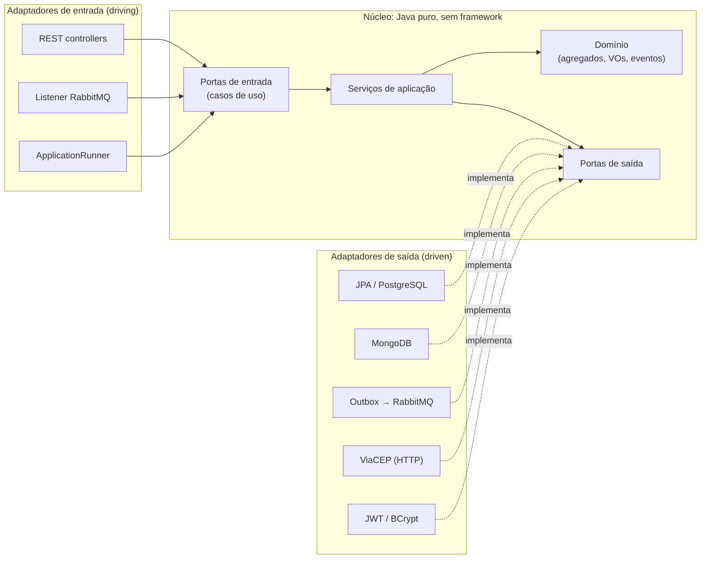

# Logistics API

[](https://github.com/matheusLima-jv/lab_01/actions/workflows/ci.yml)

API REST de **envios e rastreamento de encomendas**, construída como **projeto de referência**
de arquitetura hexagonal, Clean Architecture e DDD com Java 21 e Spring Boot 4.

O domínio é pequeno de propósito (cadastro, login, criar envio, despachar, entregar, cancelar
e rastrear), mas cada camada usa as práticas de uma entrega profissional. Todas as classes e
arquivos de configuração trazem comentários explicando o **porquê** de cada decisão, incluindo
as alternativas descartadas e o que **não** é verdade sobre cada tema.

> **Para estudar:** comece pelo [guia de estudo](docs/12-guia-de-estudo.md), que propõe uma
> ordem de leitura do código por fases, com exercícios.

---

## Sumário

- [O que este projeto demonstra](#o-que-este-projeto-demonstra)
- [Stack](#stack)
- [Como rodar](#como-rodar)
- [Experimentando a API](#experimentando-a-api)
- [Endpoints](#endpoints)
- [Arquitetura em uma página](#arquitetura-em-uma-página)
- [Estrutura do código](#estrutura-do-código)
- [Testes](#testes)
- [Documentação detalhada](#documentação-detalhada)
- [Decisões de arquitetura (ADRs)](#decisões-de-arquitetura-adrs)
- [O que ficou de fora (e por quê)](#o-que-ficou-de-fora-e-por-quê)

---

## O que este projeto demonstra

| Conceito | Onde ver no código | Documento |
|---|---|---|
| Arquitetura hexagonal (portas e adaptadores) | `*/application/port/{in,out}`, `*/adapter/{in,out}` | [Arquitetura](docs/02-arquitetura.md) |
| Clean Architecture (regra de dependência) | domínio e aplicação sem Spring, verificado pelo `ArchitectureTest` | [Arquitetura](docs/02-arquitetura.md) |
| DDD tático: agregados, Value Objects, eventos, domain service | `shipping/domain`, `identity/domain` | [Domínio e DDD](docs/03-dominio-ddd.md) |
| DDD estratégico: bounded contexts, shared kernel, ACL | pacotes `identity`, `shipping`, `shared`; adaptador ViaCEP | [Domínio e DDD](docs/03-dominio-ddd.md) |
| API REST nível 2 de Richardson + RFC 9457 (Problem Details) | `ShipmentController`, `GlobalExceptionHandler` | [API REST](docs/04-api-rest.md) |
| Contrato OpenAPI verificado por teste e roteiro executável de requisições | `OpenApiConfig`, `OpenApiContractIT`, `docs/api/requests.http` | [API REST](docs/04-api-rest.md) |
| Segurança com JWT (Spring Security Resource Server) | `shared/infrastructure/security`, `JwtAccessTokenIssuer` | [Segurança](docs/05-seguranca.md) |
| PostgreSQL + Flyway + JPA com bloqueio otimista | `db/migration`, `ShipmentPersistenceAdapter` | [Persistência](docs/06-persistencia.md) |
| MongoDB como read model (CQRS) | `MongoTrackingHistoryStore` | [Persistência](docs/06-persistencia.md) |
| RabbitMQ com Transactional Outbox, DLQ e consumidor idempotente | `shared/infrastructure/outbox`, `TrackingProjectionListener` | [Mensageria](docs/07-mensageria.md) |
| API externa (ViaCEP) com timeout, retry, circuit breaker e cache | `ViaCepPostalCodeLookup` | [Integração externa](docs/08-integracao-externa.md) |
| Beans: `@Bean` vs `@Component`, escopos, `@ConfigurationProperties`, profiles | `*/config`, `application*.yml` | [Beans e configuração](docs/11-beans-e-configuracao.md) |
| Testes: unitários, fatias, Testcontainers, WireMock, ArchUnit, JaCoCo | `src/test` | [Testes](docs/09-testes.md) |
| Docker multi-stage, docker compose, CI | `Dockerfile`, `docker-compose.yml`, `.github/workflows` | [Execução e operação](docs/10-execucao-e-operacao.md) |

---

## Stack

| Tecnologia | Versão | Papel | Por que esta escolha |
|---|---|---|---|
| Java | 21 (LTS) | linguagem | records, sealed interfaces, pattern matching, virtual threads |
| Spring Boot | 4.1 | framework | geração atual (Spring 7, Jakarta EE 11, Jackson 3) |
| PostgreSQL | 17 | fonte da verdade | ACID, constraints, `JSONB`, `FOR UPDATE SKIP LOCKED` |
| Flyway | 12 | migrações de schema | schema versionado e revisável, e não gerado pelo Hibernate |
| MongoDB | 8.0 | read model de rastreamento | documentos de esquema flexível, projeção descartável |
| RabbitMQ | 4.1 | mensageria | topic exchange, filas quorum, dead-lettering |
| Resilience4j | 2.4 | resiliência | retry e circuit breaker com métricas no Actuator |
| Caffeine | 3.2 | cache local | cache de CEPs sem infraestrutura extra |
| springdoc-openapi | 3.1 | documentação da API | OpenAPI 3 + Swagger UI gerados do código |
| JUnit 6, AssertJ, Mockito | — | testes | padrão do Spring Boot |
| Testcontainers | 2.0 | testes de integração | bancos e broker reais em Docker |
| WireMock | 3.13 | testes de integração HTTP | simula a ViaCEP, inclusive falhas de rede |
| ArchUnit | 1.5 | testes de arquitetura | regras de dependência executáveis |
| JaCoCo | 0.8 | cobertura | gate de 90% linhas / 80% branches no `mvn verify` |

---

## Como rodar

### Pré-requisitos

- **Docker** (Desktop, Engine ou Podman com socket compatível).
- **Java 21+** apenas se for rodar fora do Docker. O Maven não precisa ser instalado: o projeto
  traz o Maven Wrapper (`./mvnw`).

### Opção 1: tudo no Docker (mais simples)

```bash
docker compose up --build -d
```

Em cerca de 1 minuto: API em `http://localhost:8080`, Swagger em
`http://localhost:8080/swagger-ui.html`, painel do RabbitMQ em `http://localhost:15672`
(`logistics` / `logistics`). Já existe um operador criado: `operador@logistics.local` /
`operador-local-123`.

Para trocar os segredos de desenvolvimento, copie `.env.example` para `.env` e ajuste.
Para derrubar e apagar os dados: `docker compose down -v`.

### Opção 2: API na IDE, infraestrutura no Docker (melhor para desenvolver)

```bash
docker compose up -d postgres mongo rabbitmq
./mvnw spring-boot:run -Dspring-boot.run.profiles=local
```

O perfil `local` traz o segredo JWT de desenvolvimento, cria o operador e libera CORS para
front-ends locais. Na IDE, rode `LogisticsApplication` com o perfil `local` ativo.

### Opção 3: sem docker compose, com Testcontainers

```bash
./mvnw spring-boot:test-run
```

Sobe a API e cria PostgreSQL, MongoDB e RabbitMQ em containers descartáveis, já conectados
(classe `TestLogisticsApplication`). Útil para experimentar sem configurar nada.

---

## Experimentando a API

O arquivo [`docs/api/requests.http`](docs/api/requests.http) é um roteiro executável com 42
requisições: a jornada completa, as quatro faixas de frete, os erros e a parte operacional, cada
uma com asserts. Ele roda no IntelliJ (HTTP Client), no terminal com a CLI oficial da JetBrains e
no VS Code com a extensão httpYac. A extensão REST Client não serve, porque não executa os
scripts que capturam o token. Pelo terminal, só com Docker:

```bash
docker run --rm --network host -v "$PWD/docs/api:/workdir" jetbrains/intellij-http-client requests.http
# 42 requests completed, 0 have failed tests
```

Com `curl`, o essencial:

```bash
# 1. Cadastro (público)
curl -X POST localhost:8080/api/v1/users -H 'Content-Type: application/json' \
  -d '{"email":"ana@example.com","password":"senha-forte-123"}'

# 2. Login: guarde o accessToken
TOKEN=$(curl -s -X POST localhost:8080/api/v1/auth/token -H 'Content-Type: application/json' \
  -d '{"email":"ana@example.com","password":"senha-forte-123"}' | jq -r .accessToken)

# 3. Criar um envio: a API consulta os CEPs na ViaCEP e calcula o frete
curl -X POST localhost:8080/api/v1/shipments -H "Authorization: Bearer $TOKEN" \
  -H 'Content-Type: application/json' \
  -d '{"origin":{"postalCode":"01001-000","number":"100"},
       "destination":{"postalCode":"20040-020","number":"10"},
       "weightGrams":1500}'
# -> 201 Created, frete R$ 30,00 (mesma região: 25,00 + 2,50 x 2 kg)

# 4. Como operador, despachar o envio (substitua {id})
OP=$(curl -s -X POST localhost:8080/api/v1/auth/token -H 'Content-Type: application/json' \
  -d '{"email":"operador@logistics.local","password":"operador-local-123"}' | jq -r .accessToken)
curl -X POST localhost:8080/api/v1/shipments/{id}/dispatch -H "Authorization: Bearer $OP"

# 5. Rastreamento (atualizado de forma assíncrona via RabbitMQ -> MongoDB)
curl localhost:8080/api/v1/shipments/{id}/tracking -H "Authorization: Bearer $TOKEN"
```

---

## Endpoints

| Método | Rota | Acesso | Descrição | Respostas |
|---|---|---|---|---|
| `POST` | `/api/v1/users` | público | cadastra um cliente | 201, 400, 409 |
| `GET` | `/api/v1/users/{id}` | a própria pessoa ou operador | consulta usuário | 200, 404 |
| `POST` | `/api/v1/auth/token` | público | login, emite JWT | 200, 400, 401 |
| `POST` | `/api/v1/shipments` | autenticado | cria envio (ViaCEP + frete) | 201, 400, 422, 503 |
| `GET` | `/api/v1/shipments` | autenticado | lista paginada (cliente: só os seus) | 200, 400 |
| `GET` | `/api/v1/shipments/{id}` | dono ou operador | consulta envio | 200, 404 |
| `POST` | `/api/v1/shipments/{id}/dispatch` | operador | `CREATED → IN_TRANSIT` | 200, 403, 404, 409 |
| `POST` | `/api/v1/shipments/{id}/deliver` | operador | `IN_TRANSIT → DELIVERED` | 200, 403, 404, 409 |
| `POST` | `/api/v1/shipments/{id}/cancel` | dono ou operador | `CREATED → CANCELLED` | 200, 400, 404, 409 |
| `GET` | `/api/v1/shipments/{id}/tracking` | dono ou operador | linha do tempo (MongoDB) | 200, 404 |
| `GET` | `/actuator/health` | público | saúde (detalhes só para operador) | 200, 503 |
| `GET` | `/actuator/metrics` | operador | métricas | 200, 403 |

Todos os erros seguem a **RFC 9457** (`application/problem+json`), com um `code` estável e o
`correlationId` da requisição. Detalhes em [API REST](docs/04-api-rest.md).

---

## Arquitetura em uma página



**A regra de ouro:** as dependências de código apontam sempre **para dentro**. O domínio não
conhece nada; a aplicação conhece o domínio e define portas (interfaces); os adaptadores
implementam as portas usando frameworks. Trocar PostgreSQL por outro banco, RabbitMQ por Kafka
ou ViaCEP por outra API muda um adaptador, e nenhuma regra de negócio. O `ArchitectureTest` faz
o build falhar se essa regra for quebrada.

**O fluxo mais completo (criar um envio):**

1. `ShipmentController` recebe o JSON, valida o formato e monta o `CreateShipmentCommand`.
2. `CreateShipmentService` valida o peso, consulta os dois CEPs na ViaCEP **fora** de transação,
   calcula o frete no domain service `FreightCalculator`.
3. Em uma transação curta, cria o agregado `Shipment` e grava o envio **e** o evento
   `ShipmentCreated` (na tabela de outbox) atomicamente.
4. O `OutboxRelay` publica o evento no RabbitMQ e espera a confirmação do broker.
5. O `TrackingProjectionListener` consome o evento e grava a linha do tempo no MongoDB (de forma
   idempotente).

Diagramas de sequência e explicação completa em [Arquitetura](docs/02-arquitetura.md).

---

## Estrutura do código

```
src/main/java/com/matheuslima/logistics
├── LogisticsApplication.java          # ponto de entrada (vazio de propósito)
├── shared/                            # compartilhado entre os contextos
│   ├── domain/                        # shared kernel: AggregateRoot, DomainEvent, exceções
│   ├── application/                   # Requester, paginação, porta TransactionRunner
│   └── infrastructure/                # transversal: segurança, web, outbox, cache, OpenAPI
├── identity/                          # bounded context: usuários e autenticação
│   ├── domain/                        # User, Email, RawPassword, PasswordHash...
│   ├── application/
│   │   ├── port/in/                   # casos de uso (interfaces) + commands + views
│   │   ├── port/out/                  # UserRepository, PasswordHasher, AccessTokenIssuer
│   │   └── service/                   # implementações dos casos de uso (sem Spring)
│   ├── adapter/
│   │   ├── in/web/                    # controllers e DTOs HTTP
│   │   ├── in/startup/                # bootstrap do operador
│   │   ├── out/persistence/           # JPA
│   │   └── out/security/              # JWT e BCrypt
│   └── config/                        # composition root: @Bean dos casos de uso
└── shipping/                          # bounded context: envios (core domain)
    ├── domain/                        # Shipment, Address, Money, eventos, máquina de estados
    │   └── freight/                   # FreightCalculator (domain service) e tabela de preços
    ├── application/                   # portas e serviços (mesma estrutura de identity)
    ├── adapter/
    │   ├── in/web/                    # ShipmentController
    │   ├── in/messaging/              # listener RabbitMQ → projeção de rastreamento
    │   ├── messaging/                 # contrato das mensagens (compartilhado in/out)
    │   ├── out/persistence/           # JPA + Specifications
    │   ├── out/tracking/              # MongoDB
    │   ├── out/viacep/                # cliente HTTP resiliente
    │   └── out/messaging/             # publicação via outbox
    └── config/                        # beans, topologia RabbitMQ, cliente ViaCEP
```

---

## Testes

```bash
./mvnw test      # rápidos: unitários, fatias web, WireMock, ArchUnit (sem Docker), ~30 s
./mvnw verify    # tudo: + integração com Testcontainers + gate de cobertura (precisa de Docker)
```

| Nível | Quantidade | Ferramentas | O que garante |
|---|---|---|---|
| Domínio e aplicação | ~140 | JUnit 6, AssertJ, fakes | regras de negócio, sem Spring nem banco, em milissegundos |
| Adaptadores (fatias) | ~60 | `@WebMvcTest`, WireMock, Mockito | contrato HTTP, segurança, integração ViaCEP, publisher confirms |
| Arquitetura | 13 regras | ArchUnit | dependências apontando para dentro, contextos isolados |
| Integração | 12 | Testcontainers, `@DataJpaTest`, `@DataMongoTest` | SQL, JSONB, locks, índices e idempotência em bancos reais |
| Ponta a ponta | 11 | `@SpringBootTest`, `RestTestClient`, Awaitility | jornadas completas, outbox → RabbitMQ → MongoDB, DLQ, contrato OpenAPI |

Cobertura atual em torno de **99% das linhas e 86% dos branches**; o build falha abaixo de
90% / 80%. Relatório em `target/site/jacoco/index.html`. Estratégia completa em
[Testes](docs/09-testes.md).

---

## Documentação detalhada

| # | Documento | Conteúdo |
|---|---|---|
| 01 | [Visão geral](docs/01-visao-geral.md) | o problema, a linguagem ubíqua, regras de negócio e escopo |
| 02 | [Arquitetura](docs/02-arquitetura.md) | hexagonal + Clean Architecture, camadas, fluxos, diagramas |
| 03 | [Domínio e DDD](docs/03-dominio-ddd.md) | agregados, Value Objects, eventos, bounded contexts |
| 04 | [API REST](docs/04-api-rest.md) | convenções, status codes, erros, paginação, exemplos |
| 05 | [Segurança](docs/05-seguranca.md) | JWT, Spring Security, autorização, ameaças mitigadas |
| 06 | [Persistência](docs/06-persistencia.md) | PostgreSQL, Flyway, JPA, MongoDB, transações |
| 07 | [Mensageria](docs/07-mensageria.md) | RabbitMQ, outbox, garantias de entrega, idempotência, DLQ |
| 08 | [Integração externa](docs/08-integracao-externa.md) | ViaCEP, timeouts, retry, circuit breaker, cache |
| 09 | [Testes](docs/09-testes.md) | pirâmide, ferramentas, como escrever cada tipo |
| 10 | [Execução e operação](docs/10-execucao-e-operacao.md) | Docker, configuração, observabilidade, troubleshooting |
| 11 | [Beans e configuração](docs/11-beans-e-configuracao.md) | IoC/DI, `@Bean`, escopos, propriedades, profiles |
| 12 | [Guia de estudo](docs/12-guia-de-estudo.md) | roteiro por fases, exercícios, como reaproveitar em cases técnicos |

## Decisões de arquitetura (ADRs)

Cada decisão relevante tem um registro curto com **contexto, decisão, alternativas e
consequências**, em [`docs/adr`](docs/adr/README.md). Exemplos: por que outbox e não publicação
direta, por que JWT HS256 autoassinado, por que PostgreSQL **e** MongoDB, por que casos de uso
sem anotações do Spring.

## O que ficou de fora (e por quê)

Ficou de fora para manter o projeto estudável, e cada item tem o caminho de evolução descrito
nos documentos: refresh tokens e revogação, rate limiting, `ETag`/`If-Match`, HATEOAS,
idempotency keys em `POST`, distributed tracing (OpenTelemetry), CDC (Debezium) no lugar do
polling do outbox, UUID v7 e testes de carga. A lista comentada está no
[guia de estudo](docs/12-guia-de-estudo.md#evoluções-sugeridas).
