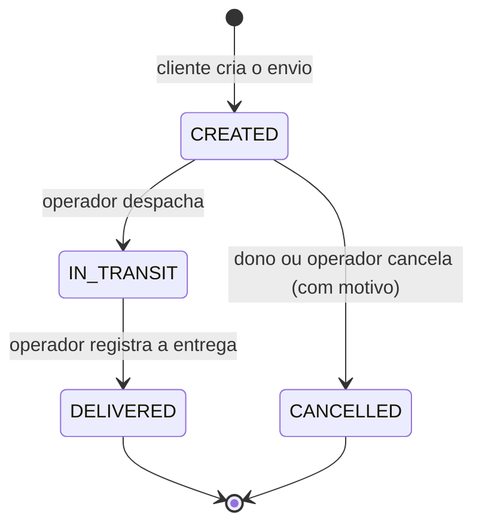

# 01. Visão geral: o problema e as regras de negócio

Este documento descreve **o que** o sistema faz, na linguagem do negócio, sem falar de
tecnologia. É o ponto de partida de qualquer projeto DDD: entender o domínio antes de desenhar
código.

## O problema

Uma transportadora precisa de uma API para que **clientes** registrem envios de encomendas e
acompanhem o rastreamento, e para que a **operação** (equipe interna) registre o andamento físico
dos pacotes: coleta (despacho) e entrega.

Requisitos que moldaram o desenho:

1. O cliente informa só o que sabe: **CEP, número e complemento** de origem e destino, mais o
   **peso**. Logradouro, bairro, cidade e UF vêm de uma fonte oficial (ViaCEP). Dois motivos:
   menos digitação, e não dá para "mentir" a UF para pagar um frete menor.
2. O **frete** é calculado pelo sistema, nunca informado pelo cliente.
3. Um envio passa por estados bem definidos, e nem toda mudança é permitida.
4. O cliente acompanha uma **linha do tempo** legível ("Objeto em trânsito").
5. Clientes só enxergam os próprios envios. Operadores enxergam todos.

## Linguagem ubíqua (glossário)

DDD chama de *linguagem ubíqua* o vocabulário comum entre especialistas do negócio e
desenvolvedores, usado igual na conversa, na documentação e **no código**. Por isso as classes têm
exatamente estes nomes:

| Termo | No código | Significado |
|---|---|---|
| Envio | `Shipment` | uma encomenda registrada para transporte, de uma origem a um destino |
| Cliente | `CustomerId` (contexto de envios) | dono de envios; no contexto de identidade, é um `User` |
| Usuário | `User` | quem acessa o sistema, com e-mail, senha e papel |
| Operador | `Role.OPERATOR` | equipe interna que despacha e entrega |
| CEP | `PostalCode` | código postal brasileiro de 8 dígitos |
| Endereço | `Address` | CEP + logradouro + número + complemento + bairro + cidade + UF |
| UF | `BrazilianState` | unidade federativa; pertence a uma região |
| Região | `Region` | macrorregião do IBGE (Norte, Nordeste, Centro-Oeste, Sudeste, Sul) |
| Peso | `Weight` | em gramas, de 1 g a 30 kg |
| Frete | `Money` (campo `freight`) | preço do transporte, calculado pela tabela |
| Tabela de frete | `FreightTable` | taxa base por tipo de rota + valor por quilo iniciado |
| Tipo de rota | `RouteType` | mesma cidade, mesmo estado, mesma região ou inter-regional |
| Despachar | `Shipment.dispatch()` | registrar que o pacote foi coletado e está em trânsito |
| Entregar | `Shipment.deliver()` | registrar que o pacote chegou ao destinatário |
| Cancelar | `Shipment.cancel(reason)` | desistir do envio antes do despacho, com motivo |
| Rastreamento | `TrackingEntry`, `/tracking` | linha do tempo dos fatos de um envio |

## Ciclo de vida de um envio



Regras, cada uma com seu motivo de negócio:

| Regra | Motivo | Onde está |
|---|---|---|
| Só envios `CREATED` podem ser cancelados | depois do despacho, o pacote está na rede de transporte; interrompê-lo é outro processo (logística reversa) | `ShipmentStatus.canTransitionTo` |
| Cancelamento exige motivo (até 255 caracteres) | atendimento e análise de causas ("muitos cancelamentos por frete caro") | `Shipment.cancel` |
| Só operadores despacham e entregam | são fatos da operação física; um cliente não pode marcar o próprio pacote como entregue | `ChangeShipmentStatusService` + `@PreAuthorize` |
| Estados finais (`DELIVERED`, `CANCELLED`) não mudam | histórico confiável | `ShipmentStatus` |
| Peso entre 1 g e 30 kg | limite de encomendas (PAC/SEDEX); acima disso é carga, outro processo | `Weight` |
| Cliente só vê e altera os próprios envios | privacidade e segurança (OWASP API1) | `ShipmentAccess` |

## Cálculo do frete

```
frete = taxa base da rota + (valor por kg × quilos iniciados)
```

Quilos "iniciados" seguem a prática das transportadoras: 1 g a 1.000 g contam como 1 kg;
1.001 g contam como 2 kg.

| Rota | Quando | Taxa base (padrão) |
|---|---|---|
| `SAME_CITY` | mesma cidade e UF | R$ 12,00 |
| `SAME_STATE` | mesma UF, cidades diferentes | R$ 18,00 |
| `SAME_REGION` | mesma região, UFs diferentes | R$ 25,00 |
| `INTERREGIONAL` | regiões diferentes | R$ 35,00 |

Valor por quilo iniciado: **R$ 2,50**. Os valores ficam em `app.shipping.freight.*`, no
`application.yml`, e podem mudar sem alterar o código.

Exemplos usados nos testes (`FreightCalculatorTest`):

| Origem → destino | Peso | Rota | Frete |
|---|---|---|---|
| São Paulo/SP → São Paulo/SP | 500 g | mesma cidade | 12,00 + 2,50 × 1 = **R$ 14,50** |
| São Paulo/SP → Campinas/SP | 1,5 kg | mesmo estado | 18,00 + 2,50 × 2 = **R$ 23,00** |
| São Paulo/SP → Rio de Janeiro/RJ | 1,5 kg | mesma região | 25,00 + 2,50 × 2 = **R$ 30,00** |
| São Paulo/SP → Manaus/AM | 30 kg | inter-regional | 35,00 + 2,50 × 30 = **R$ 110,00** |

## Papéis e permissões

| Ação | Cliente | Operador |
|---|---|---|
| Cadastrar-se | ✅ (o cadastro público sempre cria `CUSTOMER`) | criado pelo bootstrap |
| Criar envio | ✅ (dono = quem cria) | ✅ |
| Ver/listar envios | só os próprios | todos |
| Cancelar | só os próprios, se `CREATED` | qualquer um, se `CREATED` |
| Despachar / entregar | ❌ (403) | ✅ |
| Ver rastreamento | só dos próprios | de todos |
| Ver métricas (`/actuator/metrics`) | ❌ | ✅ |

## Escopo: o que está deliberadamente fora

Para manter o projeto estudável: pagamento do frete, logística reversa (devolução), múltiplos
volumes por envio, previsão de entrega, notificações por e-mail/SMS e prazos por modalidade. Cada
um poderia virar um novo caso de uso, ou um novo bounded context, sem alterar a estrutura
existente. Esse é justamente o benefício da arquitetura escolhida.
