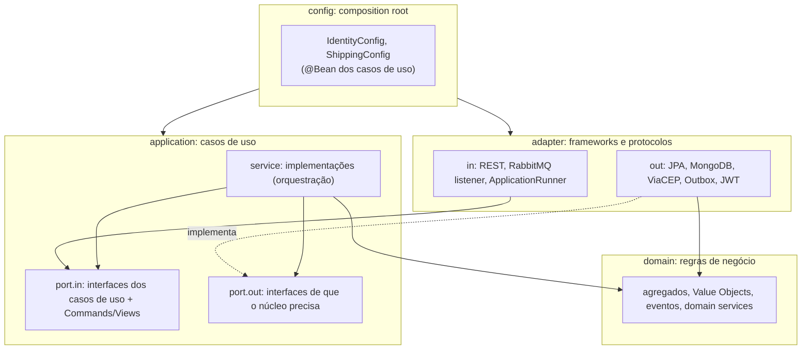
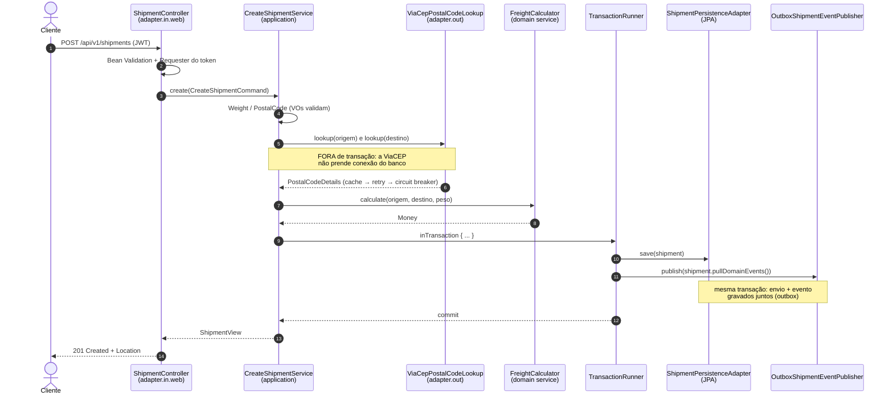
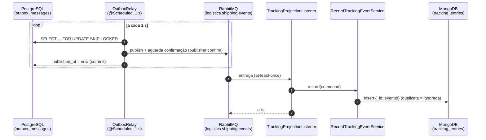
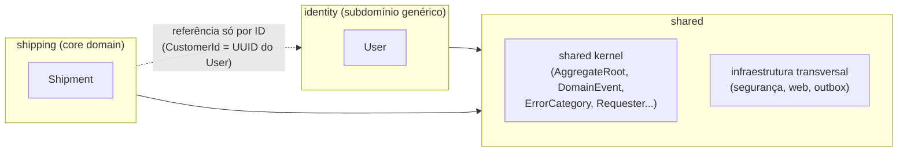

# 02. Arquitetura: hexagonal + Clean Architecture

> **Resumo:** o núcleo da aplicação (domínio + casos de uso) é Java puro e não conhece Spring,
> banco, HTTP nem RabbitMQ. Ele define **portas** (interfaces), e a infraestrutura fornece
> **adaptadores** que as implementam. As dependências de código apontam sempre para dentro, e um
> teste de arquitetura (ArchUnit) garante isso a cada build.

## Por que essa arquitetura?

A pergunta certa não é "qual a arquitetura mais bonita", e sim "o que muda, e com que
frequência". Em sistemas corporativos:

- **Regras de negócio** duram anos e são o ativo mais valioso.
- **Tecnologia** muda o tempo todo: versão do framework, troca de banco, nova API de CEP, Kafka no
  lugar de RabbitMQ.

Se as regras estão misturadas com a tecnologia (um `@Service` que faz `if` de negócio, chama o
`RestTemplate` e o `EntityManager`), cada troca tecnológica é uma cirurgia nas regras, e testar
uma regra exige subir banco e servidor. A arquitetura hexagonal separa as duas coisas para que
evoluam independentemente.

**O que NÃO é verdade:** "arquitetura hexagonal é para projetos grandes". O custo dela é baixo
(algumas interfaces e mapeamentos) e o ganho aparece cedo: testes de regra em milissegundos,
sem Docker. Ela só é exagero para scripts descartáveis ou CRUDs sem regra nenhuma.

## Os três nomes, a mesma ideia

| Arquitetura | Autor | Ênfase |
|---|---|---|
| **Hexagonal** (Ports & Adapters) | Alistair Cockburn, 2005 | a aplicação fala com o mundo só por portas; cada tecnologia é um adaptador plugável |
| **Onion** | Jeffrey Palermo, 2008 | camadas concêntricas com o domínio no centro |
| **Clean Architecture** | Robert C. Martin, 2012 | a *regra de dependência*: código só depende de círculos mais internos |

Este projeto usa o vocabulário da hexagonal (portas de entrada/saída, adaptadores) e a regra
de dependência da Clean Architecture.

## As camadas



| Camada | Pode depender de | Não pode depender de | Exemplo |
|---|---|---|---|
| `domain` | só Java e `shared.domain` | aplicação, adaptadores, Spring, JPA, Jackson | `Shipment`, `Money` |
| `application` | domínio | adaptadores, Spring, JPA | `CreateShipmentService` |
| `adapter` | aplicação, domínio, `shared.infrastructure` | outros adaptadores de direção oposta | `ShipmentController` |
| `config` | tudo (é onde as peças se conectam) | — (ninguém depende dela) | `ShippingConfig` |
| `shared.infrastructure` | aplicação, domínio | contextos específicos | `SecurityConfig`, outbox |

Essas regras estão codificadas em `ArchitectureTest` (`layeredArchitecture()` e outras). Para ver
o teste falhar, crie no domínio uma classe que importe algo do Spring e rode `./mvnw test`.

### Portas de entrada (driving ports)

O que a aplicação **oferece**: uma interface por caso de uso (`CreateShipmentUseCase`,
`ChangeShipmentStatusUseCase`...), com seus dados de entrada (Commands/Queries) e de saída
(Views). Quem chama uma porta de entrada é um **adaptador de entrada**: controller REST, listener
de fila ou runner de inicialização.

> Regra adotada: **1 caso de uso = 1 porta de entrada = 1 serviço**. Listar o pacote
> `application/port/in` mostra tudo o que o sistema faz ("Screaming Architecture").

### Portas de saída (driven ports)

O que a aplicação **precisa** do mundo externo, descrito na linguagem do domínio:
`ShipmentRepository`, `PostalCodeLookup`, `ShipmentEventPublisher`, `TrackingHistoryStore`,
`PasswordHasher`, `AccessTokenIssuer`, `TransactionRunner`. Quem implementa é um **adaptador de
saída** (JPA, ViaCEP, outbox...).

Isto é a **inversão de dependência** (o "D" do SOLID) aplicada à arquitetura: o núcleo dita o
contrato e a infraestrutura obedece.

## Fluxo 1: criar um envio (síncrono)



Pontos de atenção que este fluxo ensina:

1. **Validação em duas camadas.** O DTO valida o formato para dar mensagens por campo; os Value
   Objects garantem a integridade, porque não confiam em quem os chamou.
2. **Chamada externa fora da transação.** Uma ViaCEP lenta não pode esgotar o pool de conexões
   do banco. É o motivo de existir a porta `TransactionRunner` em vez de `@Transactional` no
   método inteiro.
3. **Atomicidade estado + evento.** O evento não vai direto para o RabbitMQ: entra na tabela
   de outbox na mesma transação (ver [Mensageria](07-mensageria.md)).

## Fluxo 2: rastreamento (assíncrono, CQRS)



O lado de **escrita** (comandos) usa o PostgreSQL, fonte da verdade com transações e regras. O
lado de **leitura** do rastreamento usa um modelo próprio no MongoDB, desenhado para a consulta
"linha do tempo do envio X". Isso é **CQRS** (Command Query Responsibility Segregation) em versão
leve: não há event sourcing, só uma projeção de leitura alimentada por eventos.

**Consequência que precisa estar documentada:** o rastreamento é *eventualmente consistente*.
Logo depois de despachar, o histórico pode levar alguns instantes (tipicamente menos de 1 s)
para mostrar o novo evento.

## Bounded contexts e o pacote `shared`



Os dois contextos **não importam classes um do outro** (verificado pelo ArchUnit). O contexto de
envios conhece o cliente apenas pelo UUID que vem no token. Isso permitiria, no futuro, extrair
cada contexto para um serviço separado sem reescrever o domínio. Por enquanto é um **monólito
modular**: um deploy, fronteiras internas claras. Detalhes em [Domínio e DDD](03-dominio-ddd.md).

## Composição: onde as peças se encontram

Os serviços da camada de aplicação não têm `@Service`. Quem os transforma em beans são as classes
`IdentityConfig` e `ShippingConfig`, com métodos `@Bean` que recebem as portas de saída por
parâmetro. O Spring resolve cada porta pelo tipo, encontrando o adaptador anotado com
`@Component`/`@Repository`. A explicação completa está em
[Beans e configuração](11-beans-e-configuracao.md).

## Modelos em cada camada (e o custo de mapear)

O mesmo envio aparece em quatro formatos:

| Modelo | Camada | Por que existe |
|---|---|---|
| `CreateShipmentRequest` / `ShipmentResponse` | adaptador web | contrato HTTP: validação, documentação OpenAPI, formato JSON |
| `CreateShipmentCommand` / `ShipmentView` | aplicação | contrato do caso de uso, sem HTTP |
| `Shipment` | domínio | regras e invariantes |
| `ShipmentJpaEntity` | adaptador de persistência | formato do banco, com anotações JPA |

Mapear custa código. O ganho: renomear um campo do JSON não toca no domínio; mudar o schema do
banco não quebra a API; o agregado não precisa ter construtor vazio nem setters por exigência do
JPA. Em CRUDs triviais, esse custo pode não compensar. Aqui, com regras reais, compensa.

## Estrutura de pacotes: por contexto, depois por camada

```
shipping/                 ← primeiro o assunto (bounded context)
  domain/                 ← depois a camada
  application/port/in|out, service
  adapter/in|out
  config/
```

Organizar primeiro por camada (`controllers/`, `services/`, `repositories/` na raiz) espalha cada
funcionalidade pelo projeto inteiro. Organizar por contexto mantém junto o que muda junto, e
torna as fronteiras visíveis (e testáveis).
