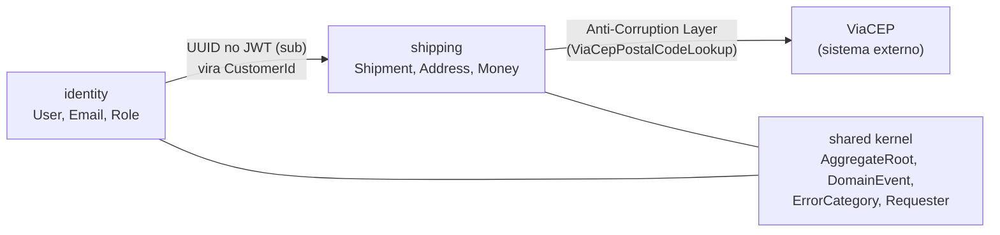

# 03. Domínio e DDD

> **Resumo:** DDD (Domain-Driven Design, Eric Evans, 2003) tem duas metades. A **estratégica**
> decide *como dividir* o sistema (bounded contexts). A **tática** decide *como modelar* cada parte
> (agregados, Value Objects, eventos...). Este projeto usa as duas, cada padrão com uma razão
> concreta para estar ali.

## DDD estratégico

### Subdomínios

| Subdomínio | Tipo | Por quê | Investimento |
|---|---|---|---|
| Envios e frete (`shipping`) | **core** | é onde a empresa se diferencia (regras de frete, ciclo do envio) | modelo rico, testes de regra, DDD tático completo |
| Identidade (`identity`) | **genérico** | todo sistema tem login; não diferencia ninguém | simples; em produção, candidato a Keycloak/Auth0 |
| CEP (ViaCEP) | **genérico, externo** | dado de terceiros | consumido por uma Anti-Corruption Layer |

**O que NÃO é verdade:** "DDD é aplicar todos os padrões em todo lugar". A regra é investir
onde está o diferencial (core) e simplificar o resto.

### Bounded contexts

Um *bounded context* é uma fronteira dentro da qual um modelo e sua linguagem são consistentes.
A mesma pessoa é um **User** (credenciais e papel) em `identity` e um **Customer** (dono de envios)
em `shipping`. Cada contexto tem o próprio modelo; eles se relacionam apenas pelo identificador.

Relações do *context map*:

- **Shared Kernel** (`shared.domain`, `shared.application`): um núcleo pequeno, compartilhado e
  estável. Deve permanecer pequeno, porque toda mudança nele afeta todos os contextos.
- **Anti-Corruption Layer** (ACL): o adaptador da ViaCEP traduz o JSON em português da API
  externa (`logradouro`, `localidade`, `uf`, `"erro": "true"`) para o modelo da porta
  (`PostalCodeDetails`). O formato de terceiros nunca entra no núcleo.
- **Published Language**: o contrato `ShipmentEventMessage` é a linguagem publicada pelos
  eventos de envio, versionada (`schemaVersion`) e independente do modelo interno.

Isolamento verificado: `ArchitectureTest.contextsAreIndependent` falha se `shipping` importar
algo de `identity` (ou vice-versa).

## DDD tático

### Value Objects

Objetos definidos pelo **valor**, sem identidade: `Email`, `PostalCode`, `Address`, `Weight`,
`Money`, `BrazilianState`, `RawPassword`, `PasswordHash`.

Propriedades e como cada uma é garantida:

| Propriedade | Como | Exemplo |
|---|---|---|
| Imutável | `record` (campos `final`, sem setters) | `Money` |
| Sempre válido | validação no construtor compacto ("parse, don't validate") | `PostalCode` rejeita "123" |
| Normalizado | o construtor converte para a forma canônica | `Email` em minúsculas com `Locale.ROOT` |
| Igualdade por valor | `equals` do record, com escala normalizada | `Money.brl("10") == Money.brl("10.00")` |
| Comportamento próprio | métodos que fazem sentido para o valor | `Weight.kilogramsRoundedUp()`, `Money.plus()` |

**Por que tipos pequenos em vez de `String`/`int`?** Com `String email`, toda função que recebe um
e-mail precisa desconfiar dele. Com `Email`, se o objeto existe, ele é válido. A validação
acontece uma vez, na fronteira, e o compilador impede trocar um e-mail por um CEP.

**Identidades tipadas** (`ShipmentId`, `CustomerId`, `UserId`) aplicam a mesma ideia: com
`UUID` em todo lugar, inverter dois argumentos compila; com tipos dedicados, não compila.

### Entidades e agregados

Entidades têm **identidade** que persiste no tempo: dois envios com os mesmos dados continuam
sendo envios diferentes. Igualdade por ID (`Shipment.equals`).

Um **agregado** é um grupo de objetos tratado como unidade de consistência, acessado só pela
**raiz**. `Shipment` é a raiz do agregado de envios (contém `Address`, `Weight`, `Money`);
`User` é a raiz em identidade.

Regras seguidas:

1. **Modelo rico, não anêmico.** Não existe `setStatus`. Existem `dispatch()`, `deliver()` e
   `cancel(reason)`, que validam a transição, mudam o estado e registram o evento numa operação
   só. É impossível mudar o status "esquecendo" o evento.
2. **Invariantes protegidas pela raiz.** "Só cancelados têm motivo", "transições válidas"... A
   raiz garante; o banco repete como `CHECK` (defesa extra).
3. **Uma transação altera um agregado.** Os casos de uso carregam, alteram e salvam um envio por
   transação.
4. **Referência a outros agregados só por ID.** `Shipment` guarda `CustomerId`, e não um `User`.
5. **Fábricas com nome de intenção.** `Shipment.create(...)` (nasce e emite evento) versus
   `Shipment.restore(...)` (reconstitui do banco, sem evento).

### Máquina de estados

As transições ficam num `switch` exaustivo no enum `ShipmentStatus`. Adicionar um status sem
definir suas transições é erro de compilação, e a tabela-verdade completa (16 combinações) está
em `ShipmentStatusTest`, legível como especificação.

### Eventos de domínio

Fatos que já aconteceram, no passado: `ShipmentEvent.Created`, `Dispatched`, `Delivered`,
`Cancelled`.

- **Interface `sealed` com records aninhados (Java 17+):** a hierarquia é fechada, então todo
  `switch` sobre eventos é exaustivo. Ao criar um novo evento, o compilador aponta cada lugar que
  precisa tratá-lo, inclusive o mapeamento para mensagens do RabbitMQ.
- **Registrados, não publicados, pelo agregado:** `AggregateRoot.registerEvent` guarda o evento;
  o caso de uso retira com `pullDomainEvents()` e o entrega à porta de publicação **na mesma
  transação** do agregado.
- **Carregam o estado necessário** (`customerId`, cidades...), para que consumidores não precisem
  consultar a API (*event-carried state transfer*).

### Domain Service

`FreightCalculator` calcula o frete. Não pertence a `Shipment` porque depende de dois endereços
e de uma tabela de preços com ciclo de vida próprio. Domain services são **sem estado**, falam a
linguagem do domínio e não fazem I/O.

**Não confundir com Application Service** (`CreateShipmentService`): o application service
*orquestra* (chama portas, abre transação); o domain service só contém *regra*.

### Repositórios

`ShipmentRepository` e `UserRepository` dão a ilusão de uma coleção em memória de agregados
(`save`, `findById`). A interface fica em `application.port.out` (estilo hexagonal); DDD clássico
a colocaria em `domain`. As duas posições estão dentro do hexágono, e a escolha foi pela
uniformidade: toda porta de saída mora em `port.out`.

Para o histórico de rastreamento o nome é `TrackingHistoryStore`, e não *Repository*: não é um
agregado, é uma projeção de leitura sem regras.

### Exceções de domínio com categoria

Exceções de negócio carregam um `ErrorCategory` (`INVALID_INPUT`, `NOT_FOUND`, `CONFLICT`,
`UNPROCESSABLE`...) e um `code` estável. O núcleo diz *que tipo* de problema ocorreu; cada
adaptador traduz para o seu protocolo (HTTP status no `ProblemDetailFactory.statusOf`). O domínio
não sabe o que é HTTP 409.

`null` chegando ao domínio é tratado como **bug** (`NullPointerException` → 500), e não como
entrada inválida: a borda HTTP já rejeita campos ausentes, então um `null` lá dentro indica erro
de programação, que deve aparecer em alertas e não ser mascarado como 400.

## Mapa rápido: padrão → classe

| Padrão | Classes |
|---|---|
| Aggregate Root | `Shipment`, `User` |
| Entity | `Shipment`, `User` |
| Value Object | `Email`, `RawPassword`, `PasswordHash`, `AccessToken`, `PostalCode`, `Address`, `Weight`, `Money`, `BrazilianState`, `Region`, `FreightTable`, IDs |
| Domain Event | `ShipmentEvent.*` |
| Domain Service | `FreightCalculator` |
| Factory | `Shipment.create/restore`, `User.register/restore` |
| Repository | `ShipmentRepository`, `UserRepository` (portas) |
| Application Service | `*Service` em `application/service` |
| Anti-Corruption Layer | `ViaCepPostalCodeLookup` + `ViaCepResponse` |
| Published Language | `ShipmentEventMessage` |
| Shared Kernel | `shared.domain`, `shared.application` |
