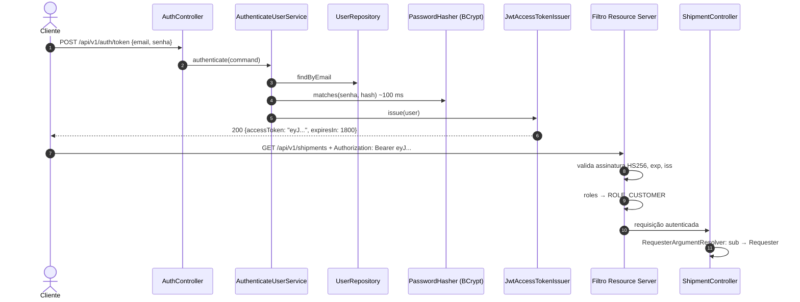

# 05. Segurança

> **Resumo:** autenticação stateless com **JWT assinado (HS256)**, emitido pela própria API e
> validado em cada requisição pelo **Resource Server do Spring Security**. Senhas com **BCrypt**.
> Autorização em três níveis: regras por URL (filtro), por papel (`@PreAuthorize`) e por dono do
> recurso (caso de uso). Erros 401/403 no mesmo formato RFC 9457 do resto da API.

## Fluxo de autenticação



## O token

```json
{ "alg": "HS256", "typ": "JWT" }
{
  "iss": "logistics-api",
  "sub": "6f1c2a9e-...",
  "roles": ["CUSTOMER"],
  "iat": 1760000000,
  "exp": 1760001800,
  "jti": "b8e1..."
}
```

| Decisão | Motivo |
|---|---|
| **HS256** (chave simétrica) | a mesma aplicação emite e valida; com várias partes validando, o caminho é RS256/ES256 com JWKS (ver [ADR 0004](adr/0004-jwt-autoassinado-hs256.md)) |
| Segredo só por variável de ambiente (`APP_SECURITY_JWT_SECRET`), mínimo 256 bits | sem padrão no `application.yml`: a aplicação não sobe com segredo conhecido |
| Validade de **30 min**, sem refresh token | JWT não é revogável antes de expirar; validade curta limita o estrago de um vazamento |
| Sem e-mail ou dado pessoal no payload | o payload é só Base64: qualquer pessoa com o token consegue ler |
| Emissor (`iss`) validado | token de outro sistema, mesmo assinado com a mesma chave, é rejeitado |
| `jti` (ID do token) | base para auditoria e uma futura lista de revogação |

**O que NÃO é verdade:** "JWT é criptografado". JWS (o formato usado) é **assinado**: garante
integridade e autoria, não sigilo. Criptografia seria JWE.

**Por que não escrever um filtro JWT próprio?** Validação de token é código de segurança, com
detalhes fáceis de errar: comparação de assinatura em tempo constante, rejeitar `alg: none`,
tolerância de relógio, validação de emissor. O `NimbusJwtDecoder` do Spring Security faz tudo isso
e é auditado pela comunidade. Tutoriais com `OncePerRequestFilter` "na mão" são uma fonte comum
de vulnerabilidades. Os testes em `SecurityAdaptersTest` provam a rejeição de tokens expirados,
forjados, adulterados, de outro emissor e com `alg: none`.

## Senhas

| Prática | Implementação |
|---|---|
| Hash lento e com salt | BCrypt (custo 10, ~100 ms) via `DelegatingPasswordEncoder` |
| Algoritmo registrado junto com o hash | prefixo `{bcrypt}`: dá para migrar para Argon2 sem resetar senhas |
| Política do NIST SP 800-63B | mínimo de 8 caracteres e **sem** regras de composição |
| Limite de 72 **bytes** | o BCrypt ignora o que passar disso; validar evita um 500 e uma falsa sensação de segurança |
| Senha nunca em log | `RawPassword`, os Commands e os DTOs têm `toString` mascarado (testado) |
| Hash calculado fora da transação | não segura conexão do banco durante ~100 ms de CPU |

## Autorização em três níveis

| Nível | Onde | Exemplo | Por que aqui |
|---|---|---|---|
| 1. URL | `SecurityConfig` | `/actuator/**` só para `OPERATOR`; tudo exige autenticação, exceto cadastro, login, health e docs | regra grossa, "negar por padrão" |
| 2. Papel por endpoint | `@PreAuthorize("hasRole('OPERATOR')")` | despacho e entrega | documenta a regra junto do endpoint; rejeita cedo |
| 3. Dono do recurso | caso de uso (`ShipmentAccess`, `Requester`) | cliente só vê os próprios envios | depende de **dados** (dono do envio), que o filtro não conhece |

O nível 2 é repetido no caso de uso (**defesa em profundidade**): o caso de uso também pode ser
chamado por outros adaptadores (fila, job), e a regra precisa valer em qualquer caminho.

## Ameaças consideradas (OWASP API Security Top 10, 2023)

| Risco | Mitigação | Teste |
|---|---|---|
| API1: Broken Object Level Authorization (IDOR) | `ShipmentAccess` + 404 para recurso alheio | `customersAreIsolated`, `otherCustomerGetsNotFound` |
| API2: Broken Authentication | Resource Server do Spring, BCrypt, mensagem única de falha, tempo equalizado no login | `unknownUserStillSpendsTimeComparing`, `SecurityAdaptersTest` |
| API3: Broken Object Property Level Authorization (mass assignment) | DTO de cadastro sem campo `role`; o controller força `CUSTOMER` | `cannotChooseOwnRole` |
| API4: Unrestricted Resource Consumption | `size` máximo 100, limites de tamanho nos campos, timeouts nas chamadas externas | `listValidation` |
| API5: Broken Function Level Authorization | `@PreAuthorize` + checagem no caso de uso | `customerCannotDispatchOrDeliver` |
| API8: Security Misconfiguration | CSRF desligado só porque não há cookies; CORS fechado por padrão; headers de segurança padrão; stack trace nunca exposto | `unexpectedErrorIsHidden` |
| API10: Unsafe Consumption of APIs | dados da ViaCEP validados (UF desconhecida ou resposta incompleta viram 503, não dados ruins) | `untrustedData` |

Outras proteções: **timing attack** no login (comparação com hash "isca" quando o usuário não
existe), **log injection** (correlation ID recebido é validado), **enumeração de usuários** no
login (mensagem única).

**Trade-off consciente:** o cadastro responde 409 para e-mail já existente, o que permite
descobrir se um e-mail tem conta. Muitos produtos aceitam isso pela usabilidade. Em sistemas
sensíveis, a alternativa é sempre responder "verifique seu e-mail" e tratar o caso por mensagem.

## Configurações que merecem explicação

- **CSRF desligado:** CSRF explora cookies enviados automaticamente pelo navegador. Esta API
  usa `Authorization: Bearer`, que o navegador nunca envia sozinho.
- **STATELESS:** nenhuma `HttpSession`; qualquer instância atende qualquer requisição.
- **CORS:** origens permitidas vêm de `CORS_ALLOWED_ORIGINS`, vazio por padrão. CORS é uma
  proteção do *navegador* e não do servidor: `curl` ignora CORS.
- **Health com detalhes só para operador:** `show-details: when-authorized` + `roles: OPERATOR`.

## Erros 401/403 consistentes

Falhas de autenticação acontecem nos filtros, antes do Spring MVC. O
`ProblemDetailAuthenticationEntryPoint` mantém o header `WWW-Authenticate` padrão (RFC 6750) e
delega a exceção ao `HandlerExceptionResolver`, que a entrega ao `GlobalExceptionHandler`.
Resultado: 401 e 403 têm o mesmo formato Problem Details de qualquer outro erro.

## O que ficaria para produção

1. **Identity Provider externo** (Keycloak, Auth0, Cognito, Entra ID) com RS256/JWKS; esta API
   viraria só Resource Server, configurado com `spring.security.oauth2.resourceserver.jwt.issuer-uri`.
2. **Refresh tokens** com rotação e revogação.
3. **Rate limiting** no login (API Gateway ou Bucket4j) e bloqueio após N falhas.
4. **Segredos em cofre** (Vault, AWS Secrets Manager), nunca em arquivo.
5. **HTTPS** obrigatório (normalmente terminado no load balancer).
6. **Confirmação de e-mail** no cadastro.
