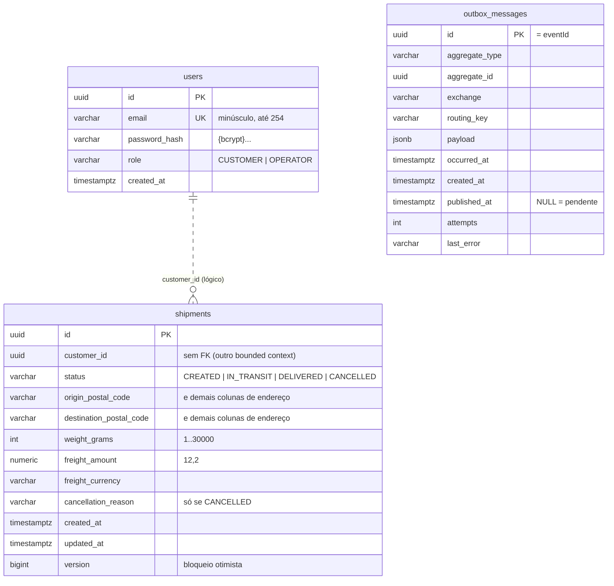

# 06. Persistência: PostgreSQL e MongoDB

> **Resumo:** PostgreSQL é a **fonte da verdade** (usuários, envios e outbox), com schema
> versionado pelo Flyway e mapeado com JPA/Hibernate. MongoDB guarda um **read model**: o
> histórico de rastreamento, derivado dos eventos e descartável. Cada banco está aqui pelo papel
> que cumpre, e não por modismo.

## Por que dois bancos?

| | PostgreSQL | MongoDB |
|---|---|---|
| Papel | fonte da verdade (escrita, comandos) | projeção de leitura (consultas de rastreamento) |
| Dados | usuários, envios, outbox | linha do tempo por envio |
| Garantias usadas | transações ACID, constraints, locks | inserção atômica por documento, chave única |
| Esquema | rígido, versionado (Flyway) | flexível (`details` varia por tipo de evento) |
| Se perder | perdeu o negócio | reconstrói reprocessando os eventos |

**O que NÃO é verdade:**
- "MongoDB é mais rápido que PostgreSQL." Depende da carga e do modelo; para este volume, uma
  tabela no PostgreSQL resolveria o histórico também.
- "NoSQL não tem schema." O schema existe; ele só não é imposto pelo banco, e sim pelo código.

A escolha se justifica pelo formato (eventos com detalhes heterogêneos), pelo papel (projeção
CQRS, que pode ser apagada e reconstruída) e pelo perfil de carga (inserção e leitura por chave,
que escalam horizontalmente sem disputar recursos com o banco transacional). Também é uma
oportunidade didática de usar os dois mundos com a mesma arquitetura: o núcleo não sabe qual
banco está atrás de cada porta. Ver [ADR 0005](adr/0005-postgresql-e-mongodb.md).

## PostgreSQL

### Modelo



### Decisões do schema (`src/main/resources/db/migration`)

| Decisão | Motivo |
|---|---|
| Flyway, `ddl-auto: validate` | o schema é revisado em code review e versionado; o Hibernate só confere se bate com as entidades e impede a subida se não bater |
| UUID gerado pela aplicação | o agregado nasce com ID (eventos, `Location`) e não expõe sequência enumerável |
| `TIMESTAMPTZ` | instante absoluto; `TIMESTAMP` sem fuso é ambíguo |
| `NUMERIC(12,2)` para dinheiro | decimal exato; `REAL`/`DOUBLE` tem erro de arredondamento |
| `VARCHAR` + `CHECK` (e não `CHAR(n)`) | a documentação do PostgreSQL desaconselha `char(n)`; o formato fica garantido por regex (`~ '^[0-9]{8}$'`) |
| `CHECK` repetindo invariantes | defesa extra contra scripts e correções manuais (`ck_shipments_cancellation`) |
| Sem FK de `shipments` para `users` | contextos diferentes se referenciam por ID; permite separá-los no futuro |
| Índices desenhados pelas consultas | `(customer_id, created_at DESC)` para "meus envios"; `(status, created_at DESC)` para o operador |
| Índice **parcial** no outbox | `WHERE published_at IS NULL`: só as pendentes ficam no índice, que continua pequeno com milhões de linhas publicadas |
| Constraint com nome explícito (`uk_users_email`) | o adaptador identifica *qual* regra foi violada pelo nome |

**Regra de ouro do Flyway:** migração aplicada nunca é editada (o Flyway guarda o checksum e
acusa a mudança). Correções viram uma nova versão (`V4__...`).

### Mapeamento JPA

As entidades JPA (`ShipmentJpaEntity`, `UserJpaEntity`, `OutboxMessage`) são **modelos de
persistência**, separados do domínio. O adaptador traduz com um mapper.

| Técnica | Onde | Por quê |
|---|---|---|
| `@Embeddable` + `@EmbeddedColumnNaming("origin_%s")` | `AddressEmbeddable` | Value Object como colunas da mesma tabela, sem 14 `@AttributeOverride` (recurso do Hibernate 7) |
| `@Enumerated(EnumType.STRING)` | status, role | `ORDINAL` (o padrão!) corromperia os dados ao reordenar o enum |
| `@Version Long` | `ShipmentJpaEntity` | bloqueio otimista; versão `null` = entidade nova = INSERT |
| `Persistable` com `isNew` transitório | `AssignedIdentifierEntity` | evita o SELECT que o Spring Data faz antes de inserir entidades com ID atribuído |
| `@JdbcTypeCode(SqlTypes.JSON)` | `OutboxMessage.payload` | grava o JSON como `JSONB` de verdade (consultável com `->>`, provado em teste) |
| Specifications | `ShipmentSpecifications` | filtros opcionais sem explosão de métodos nem `(:x IS NULL OR ...)` |
| `open-in-view: false` | `application.yml` | nenhum acesso a banco fora das transações explícitas dos casos de uso |

### Transações

A fronteira é explícita, via porta `TransactionRunner` (implementada por
`SpringTransactionRunner` com `TransactionTemplate`):

```java
// CreateShipmentService: integração externa FORA, gravação DENTRO
Address origin = resolveAddress(...);                 // ViaCEP, pode demorar
Money freight = freightCalculator.calculate(...);     // CPU, sem I/O
return transactions.inTransaction(() -> {             // transação curta
    Shipment shipment = Shipment.create(...);
    shipments.save(shipment);
    eventPublisher.publish(shipment.pullDomainEvents()); // outbox: mesma transação
    return ShipmentView.from(shipment);
});
```

Consultas usam `inReadOnlyTransaction`, em que o Hibernate desliga o *dirty checking* e o driver
pode otimizar (e numa arquitetura com réplicas, é o sinal para ler da réplica).

### Concorrência: bloqueio otimista

Dois operadores mexendo no mesmo envio ao mesmo tempo:

1. A transação A lê o envio (versão 0).
2. A transação B lê (versão 0), despacha e faz commit (versão 1).
3. A transação A tenta cancelar: `UPDATE ... WHERE id = ? AND version = 0` afeta 0 linhas.
4. O Hibernate lança o erro, o `SpringTransactionRunner` traduz para `ConcurrentUpdateException` e
   a API responde **409 CONCURRENT_UPDATE**.

Ninguém fica bloqueado esperando (diferente de `SELECT ... FOR UPDATE`), o que escala melhor
quando conflitos são raros. O teste `optimisticLockingDetectsConcurrentUpdates` reproduz o
cenário com duas transações reais.

## MongoDB

### Documento (`tracking_entries`)

```json
{
  "_id": "953d5efd-4497-493f-b9eb-d5922a64e6c1",
  "shipmentId": "356668cb-c6ab-4bcf-bece-eec6d793e8ef",
  "status": "CREATED",
  "description": "Envio registrado: São Paulo/SP → Rio de Janeiro/RJ",
  "occurredAt": { "$date": "2026-10-07T04:02:08.801Z" },
  "details": {
    "originCity": "São Paulo", "originState": "SP",
    "destinationCity": "Rio de Janeiro", "destinationState": "RJ",
    "weightGrams": "1500", "freightAmount": "30.00", "freightCurrency": "BRL"
  },
  "recordedAt": { "$date": "2026-10-07T04:02:09.420Z" }
}
```

| Decisão | Motivo |
|---|---|
| **Um documento por evento**, `_id` = ID do evento | inserção atômica e idempotência sem consulta prévia (duplicata = `DuplicateKeyException`) |
| Não um array por envio | evita update condicional (`$push` se não existir) e documento crescendo sem limite |
| `insert` e não `save` | `save` é upsert: esconderia a duplicata em vez de sinalizá-la |
| Índice `(shipmentId, occurredAt)` | atende exatamente "linha do tempo do envio X em ordem", sem ordenar em memória |
| Ordenar por `occurredAt` (e não chegada) | mensagens podem chegar fora de ordem (retries, várias instâncias) |
| UUIDs como String | legíveis no shell e sem ambiguidade de representação binária no BSON |
| Record como documento | o Spring Data MongoDB mapeia pelo construtor |
| `recordedAt` | `recordedAt - occurredAt` mede o atraso da consistência eventual |

### Por que o MongoDB fica fora da transação do PostgreSQL

Não há transação distribuída aqui, e não precisa haver. O Mongo é escrito pelo consumidor, num
fluxo próprio e idempotente. Se a gravação falhar, a mensagem volta (retry) ou vai para a DLQ. A
consistência entre os dois bancos é **eventual**, garantida pelo outbox, e não por um 2PC.

## Precisão de tempo

O PostgreSQL guarda microssegundos; o MongoDB, milissegundos. O `Clock` da aplicação
(`ClockConfig`) usa granularidade de 1 ms, para que o mesmo instante sobreviva idêntico à ida e
volta dos dois bancos e comparações não falhem de forma intermitente.
