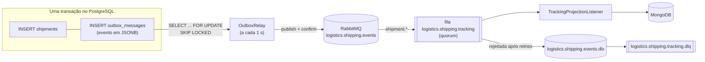
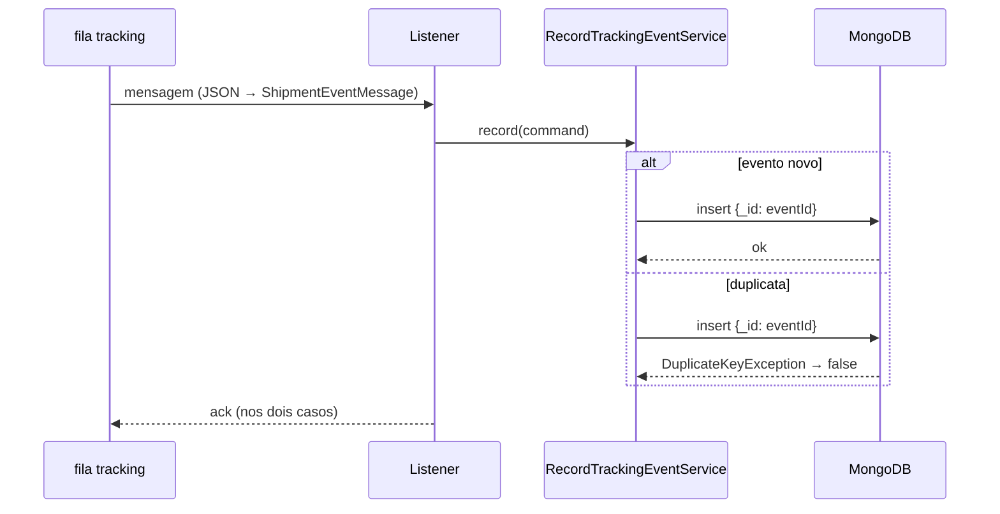

# 07. Mensageria: RabbitMQ, outbox e idempotência

> **Resumo:** eventos de domínio são gravados na tabela de **outbox** na mesma transação do
> envio. Um relay os publica no RabbitMQ com **publisher confirms**. Um consumidor
> **idempotente** projeta os eventos no MongoDB. Mensagens que falham repetidamente vão para uma
> **DLQ**. Resultado: entrega "pelo menos uma vez" + idempotência = efeito "exatamente uma vez".

## O problema da escrita dupla

Criar um envio exige duas escritas: o envio no PostgreSQL e o evento no RabbitMQ. Não existe
transação atômica entre os dois:

| Ordem | Falha no meio | Resultado |
|---|---|---|
| publica, depois commit | commit falha | o mundo ouviu falar de um envio que não existe |
| commit, depois publica | a aplicação cai | o evento se perde para sempre |
| `@TransactionalEventListener(AFTER_COMMIT)` | a aplicação cai após o commit | o evento se perde (é o caso anterior, com outro nome) |

## A solução: Transactional Outbox



O evento vira um **dado**, gravado atomicamente com o estado. Publicar passa a ser um processo
separado, que pode falhar e tentar de novo sem perder nada.

### O relay (`OutboxRelay`)

1. Abre uma transação e trava um lote de até 50 mensagens pendentes com
   `FOR UPDATE SKIP LOCKED`.
2. Para cada uma: publica, **espera a confirmação do broker** e marca `published_at`.
3. Na primeira falha, registra `attempts`/`last_error` e **interrompe o lote** (broker fora: não
   adianta insistir com a transação aberta).
4. O commit grava as marcações e libera as travas.

| Decisão | Motivo |
|---|---|
| `FOR UPDATE SKIP LOCKED` | várias instâncias dividem o trabalho sem publicar a mesma mensagem duas vezes e sem coordenador externo |
| Publisher confirms (`correlated`) | só marca como publicada depois que o broker assumiu a mensagem |
| `fixedDelay` (e não `fixedRate`) | rodadas nunca se sobrepõem |
| Agendador separado do relay (`OutboxRelayScheduler`) | testes desligam o agendamento e chamam o relay diretamente |
| Ordem por `created_at` | dentro de uma instância, os eventos saem na ordem em que aconteceram |

**O que NÃO é verdade:**
- "Com outbox, a entrega é exatamente uma vez." Se a aplicação cair depois do confirm e antes do
  commit, a mensagem sai de novo. O outbox garante "pelo menos uma vez"; a idempotência do
  consumidor fecha a conta.
- "Ack do broker significa que alguém consumiu." O ack diz só que o broker assumiu a mensagem.

**Evolução:** o polling adiciona até 1 s de latência. Para tempo real, use CDC (Change Data
Capture, por exemplo Debezium lendo o WAL do PostgreSQL). Se preferir não escrever o outbox à
mão, o Spring Modulith oferece um *event publication registry* com a mesma ideia.

## Topologia

| Recurso | Tipo | Configuração | Por quê |
|---|---|---|---|
| `logistics.shipping.events` | exchange **topic**, durável | — | o produtor publica num exchange, nunca numa fila; consumidores escolhem por padrão de routing key |
| `logistics.shipping.tracking` | fila **quorum**, durável | `x-dead-letter-exchange`, `x-dead-letter-routing-key` | quorum é o tipo durável recomendado (replicado via Raft); mensagens rejeitadas vão para o DLX |
| binding | `shipment.*` | — | a projeção quer todos os eventos de envio |
| `logistics.shipping.events.dlx` | exchange **direct** | — | recebe as mensagens "mortas" |
| `logistics.shipping.tracking.dlq` | fila quorum | — | guarda as mensagens para análise e reprocessamento manual |

Tudo declarado como **beans** em `ShippingMessagingConfig`; o `RabbitAdmin` do Spring Boot cria
os recursos no broker ao conectar (operação idempotente).

### Routing keys (tipos de evento)

| Evento de domínio | Routing key |
|---|---|
| `ShipmentEvent.Created` | `shipment.created` |
| `ShipmentEvent.Dispatched` | `shipment.dispatched` |
| `ShipmentEvent.Delivered` | `shipment.delivered` |
| `ShipmentEvent.Cancelled` | `shipment.cancelled` |

Um futuro serviço de notificação, interessado só em entregas, criaria a própria fila com binding
`shipment.delivered`, **sem nenhuma mudança no produtor**. É o ganho do pub/sub.

## Contrato da mensagem (`ShipmentEventMessage`)

```json
{
  "schemaVersion": 1,
  "eventId": "c883a666-a519-4f56-8444-e41af4878a67",
  "eventType": "shipment.cancelled",
  "occurredAt": "2026-10-07T04:02:19.783Z",
  "shipmentId": "356668cb-c6ab-4bcf-bece-eec6d793e8ef",
  "customerId": "5536852e-41c2-473d-a1a8-a0135bdeefcd",
  "status": "CANCELLED",
  "details": { "reason": "Cliente desistiu" }
}
```

Propriedades AMQP: `message_id` = `eventId`, `content_type` = `application/json`, `type` = routing
key, `delivery_mode` = persistente, headers `x-aggregate-type` e `x-aggregate-id`.

Chaves de `details` por tipo:

| Tipo | Chaves |
|---|---|
| `shipment.created` | `originCity`, `originState`, `destinationCity`, `destinationState`, `weightGrams`, `freightAmount`, `freightCurrency` |
| `shipment.cancelled` | `reason` |
| `shipment.dispatched`, `shipment.delivered` | — |

**Por que um contrato separado do evento de domínio?** Serializar o evento de domínio
diretamente acoplaria consumidores desconhecidos à estrutura interna. O contrato é a *Published
Language* (DDD): estável e versionado. O mapeamento usa `switch` sobre a interface selada, então um
evento novo sem contrato definido não compila.

**Evolução compatível:** adicionar campos ou chaves em `details` (consumidores tolerantes ignoram
o que não conhecem). **Incompatível:** remover/renomear campos ou mudar tipos; exige
`schemaVersion: 2` e, normalmente, publicar as duas versões durante a migração.

## Consumidor (`TrackingProjectionListener`)



| Situação | Comportamento | Onde está configurado |
|---|---|---|
| Sucesso | ack, a mensagem sai da fila | automático (`acknowledge-mode: auto`) |
| Duplicata | ack, ignorada (log DEBUG) | idempotência pelo `_id` |
| Falha transitória (Mongo reiniciando) | retry em memória com backoff: 1 s, 2 s, 4 s | `spring.rabbitmq.listener.simple.retry` |
| Falha permanente (JSON inválido, status desconhecido) | após os retries: rejeita sem reenfileirar → DLX → DLQ | `default-requeue-rejected: false` + argumentos da fila |

Sem DLQ, uma mensagem venenosa voltaria para a fila indefinidamente, gastando CPU e atrasando as
outras. Com DLQ, ela fica guardada para análise e, depois da correção, pode ser reenviada à fila
original (pelo painel do RabbitMQ, em `http://localhost:15672`).

Provas automatizadas: `MessagingIT.duplicateDeliveryIsIdempotent` (mesma mensagem duas vezes,
uma entrada) e `MessagingIT.poisonMessageGoesToDeadLetterQueue`.

## Ordem e consistência eventual

- Com várias instâncias publicando em paralelo, dois eventos do mesmo envio podem chegar fora de
  ordem. A projeção não depende da ordem de chegada: ordena por `occurredAt`.
- O histórico fica atrás do estado real por alguns instantes (polling de 1 s + entrega). A API
  documenta isso no endpoint de rastreamento.

## Inspecionando na prática

Com `docker compose up`, abra `http://localhost:15672` (`logistics` / `logistics`):
- **Exchanges → logistics.shipping.events**: taxa de publicação.
- **Queues → logistics.shipping.tracking**: mensagens prontas/sem ack, consumidores.
- **Queues → logistics.shipping.tracking.dlq → Get messages**: conteúdo das mensagens mortas.

No PostgreSQL:

```sql
SELECT routing_key, published_at, attempts, last_error,
       payload ->> 'shipmentId' AS shipment
  FROM outbox_messages
 ORDER BY created_at DESC
 LIMIT 10;
```
