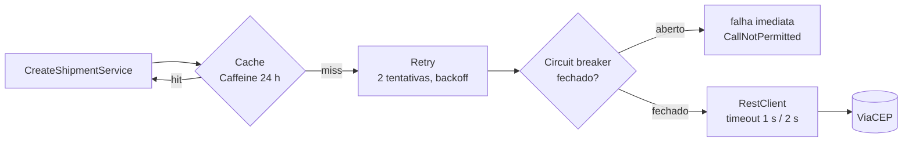

# 08. Integração externa: ViaCEP

> **Resumo:** a API consulta a [ViaCEP](https://viacep.com.br) para obter logradouro, bairro,
> cidade e UF a partir do CEP. A integração tem quatro camadas de proteção (**cache**, **retry**,
> **circuit breaker** e **timeouts**) e uma **Anti-Corruption Layer** que traduz a resposta
> externa e separa "CEP não existe" (422) de "ViaCEP fora do ar" (503).

## Por que a ViaCEP?

Pública, gratuita, sem chave de API, estável há anos e familiar para qualquer desenvolvedor
brasileiro. E tem o comportamento "imperfeito" que toda API externa tem, ótimo para estudar:

- CEP inexistente responde **HTTP 200** com `{"erro": "true"}` (versões antigas: `true` booleano);
- CEP malformado responde **HTTP 400**;
- cidades de CEP único devolvem logradouro e bairro **vazios**;
- conexões ocasionalmente resetadas: aconteceu durante o desenvolvimento deste projeto.

```bash
curl https://viacep.com.br/ws/01001000/json/
```

```json
{
  "cep": "01001-000", "logradouro": "Praça da Sé", "complemento": "lado ímpar",
  "bairro": "Sé", "localidade": "São Paulo", "uf": "SP", "ibge": "3550308", "...": "..."
}
```

## A porta e seu contrato

```java
public interface PostalCodeLookup {
    Optional<PostalCodeDetails> lookup(PostalCode postalCode); // vazio = não existe
}                                                              // exceção = indisponível
```

| Resultado da ViaCEP | O adaptador devolve | A API responde |
|---|---|---|
| 200 com dados | `Optional.of(details)` | segue o fluxo |
| 200 com `"erro": "true"` / `true` | `Optional.empty()` | **422** `POSTAL_CODE_NOT_FOUND` |
| 4xx | `Optional.empty()` (log WARN) | **422** |
| 5xx, timeout, conexão recusada/resetada | `ExternalServiceUnavailableException` | **503** + `Retry-After` |
| circuito aberto | `ExternalServiceUnavailableException` (sem ir à rede) | **503** |
| JSON ilegível, sem cidade, UF desconhecida | `ExternalServiceUnavailableException` | **503** |

Confundir "não existe" com "não consegui perguntar" é um erro clássico: o usuário acharia que
digitou errado quando o problema é a dependência.

**Dados externos são validados.** UF desconhecida ou resposta sem cidade viram 503, e não 400: o
erro é da fonte, não de quem chamou a nossa API (OWASP API10: Unsafe Consumption of APIs).

## Camadas de proteção



### 1. Timeouts (`ViaCepClientConfig`)

| Timeout | Valor | Significado |
|---|---|---|
| connect | 1 s | estabelecer TCP/TLS; se o servidor não aceita conexão em 1 s, provavelmente está fora |
| read | 2 s | esperar a resposta; baseado na latência normal da API, com folga |

**Sem timeout, uma dependência lenta derruba a sua aplicação:** cada requisição espera
indefinidamente, as threads se acumulam e endpoints que nem usam CEP param de responder. Muitos
clientes HTTP têm timeout infinito como padrão.

### 2. Retry (Resilience4j)

- Duas tentativas no total, com 200 ms de espera e backoff exponencial.
- **Só para falhas transitórias** (`ResourceAccessException`, `HttpServerErrorException`). Repetir
  um 4xx dá o mesmo resultado.
- Seguro porque a operação é um GET: idempotente.

**O que NÃO é verdade:** "mais retries = mais resiliência". Retries multiplicam a carga sobre um
serviço que já está com problemas (*retry storm*) e a latência do seu usuário.

### 3. Circuit breaker (Resilience4j)

- Janela das últimas 10 chamadas; com ao menos 5 registradas e ≥ 50% de falhas, **abre** por
  30 s: as chamadas falham na hora, sem esperar timeout.
- Depois, **meio-aberto**: deixa passar 2 chamadas de teste. Se derem certo, fecha.
- Protege a nossa aplicação (threads livres) e a ViaCEP (tempo para se recuperar).
- Estado visível em `/actuator/health` (componente `circuitBreakers`, só para operador).

### Ordem: `Retry(CircuitBreaker(chamada))`

Cada tentativa passa pelo circuit breaker, então todas contam na taxa de falha. Com o circuito
aberto, o `CallNotPermittedException` não é retentável e o retry desiste na hora. É a ordem padrão
das anotações do Resilience4j. Aqui ela fica **explícita no código** (composição programática), em
vez de escondida em proxies AOP.

### 4. Cache (Caffeine)

- `@Cacheable("postal-codes")` no adaptador, até 10.000 CEPs por 24 h.
- **Só resultados encontrados** são cacheados (`unless = "#result == null"`). Cache negativo
  poderia esconder por 24 h um CEP recém-criado pelos Correios.
- Efeito colateral bom: CEPs já conhecidos continuam funcionando com a ViaCEP fora do ar.
- `recordStats` publica hits/misses em `/actuator/metrics/cache.gets`.
- Teste: `ShipmentJourneyIT.postalCodeCache` cria dois envios com os mesmos CEPs e verifica que o
  WireMock recebeu **uma** chamada por CEP.

**Por que cache local e não Redis?** Dados públicos, quase imutáveis e baratos de buscar. Com
várias instâncias, o pior caso é cada uma consultar uma vez por CEP. Redis só se pagaria com
necessidade de consistência entre instâncias ou buscas caras.

## Orçamento de latência (pior caso)

Com a ViaCEP "travada" (aceita a conexão e não responde):

```
por CEP:  2 tentativas × 2 s (read timeout) + 0,2 s de espera ≈ 4,2 s
por envio (2 CEPs, sequenciais):                               ≈ 8,4 s
```

Depois de algumas falhas o circuito abre e as próximas requisições falham em milissegundos.
Melhorias possíveis: consultar os dois CEPs em paralelo (virtual threads) e/ou um
`TimeLimiter` para limitar o tempo total.

## Anti-Corruption Layer

`ViaCepResponse` (campos em português da API externa) existe **só** dentro do adaptador. O
núcleo recebe `PostalCodeDetails`, com nomes e tipos do nosso domínio (`BrazilianState` em vez de
`"SP"`). Trocar ViaCEP por BrasilAPI ou Correios significa escrever outro adaptador da mesma
porta, sem mexer em nenhum caso de uso.

## Como os testes cobrem a integração

| Teste | Ferramenta | O que prova |
|---|---|---|
| `ViaCepPostalCodeLookupTest` | WireMock, sem Spring | mapeamento, `erro` string/booleano, 400, 5xx com retry, conexão resetada, timeout, circuito abrindo, dados não confiáveis |
| `ShipmentJourneyIT` | WireMock + contexto completo | configuração YAML do Resilience4j, cache, 422/503 ponta a ponta |
| `ShippingUseCasesTest` | fake da porta | ViaCEP chamada **fora** da transação; indisponibilidade não grava nada |

Nenhum teste automatizado chama a ViaCEP real: testes não podem depender da internet nem da
disponibilidade de terceiros.
